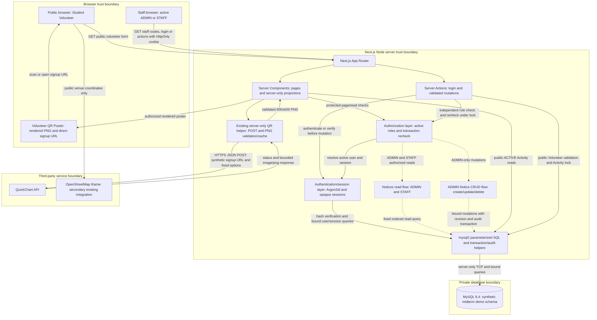

# Midterm Evidence and Submission Plan

**PLANNING — NOT IMPLEMENTED.** [STATUS.md](STATUS.md) owns readiness and gaps;
this document defines what to capture after authorized implementation. No
screenshots, recordings, exports, diagram image, PDF, or submission is created
now. Use synthetic/local data only. Every capture must come from the actual
checkpoint/run, with real date/time; do not create historical proof.

## 1. Instructor requirement → artifact matrix

Owner labels are placeholders, not assigned people. The team must map each to a
real member and record completion in STATUS. “Pending” below means uncaptured;
the coverage plan is complete, not the artifact.

| Requirement | Required artifact | How to capture | When | Owner placeholder | Status |
| --- | --- | --- | --- | --- | --- |
| Week 1 — Integration Plan v2 | Diagram with technologies, flows, integration points, dependencies and trust boundaries; accompanying short explanation | Render the Mermaid source below as a readable vector figure, caption it, and describe actual implemented checkpoint vs baseline | After implementation acceptance, before PDF assembly | [Architecture owner] | Planned; final diagram pending |
| Week 2 — working API + response used by app; proof 3 | Request body/endpoint/method, status, response headers and PNG preview; matching app poster/destination | Postman external POST with exact source settings; pair with `lib/volunteer-qr.ts` walkthrough and actual `/volunteers/poster` rendering | Rehearsal and final evidence capture with network available | [API owner] | Existing integration; fresh proof pending |
| Week 3 — DB connection, full CRUD, parameterized queries; proof 4 | Target name, before/after rows for create/update/delete, read feed, action-source excerpt, retained audit | Operator projects synthetic Notice ID/title/message/revision/actor/timestamps in DB client, then UI CRUD and bound-query source | After schema/actions pass isolated tests; same run/ID through all operations | [Database owner] | Notices/demo schema not implemented/created |
| Week 4 — login and at least two roles; proof 5 | ADMIN and STAFF authenticated views, role context, STAFF direct management denial, hash evidence | Synthetic accounts; capture hidden-password login, ADMIN management, STAFF feed then typed direct `/admin/notices`; sanitized hash projection and hashing source | After guarded fixtures and role tests; before recording | [Authentication owner] | R1 baseline exists; new restriction/proof pending |
| Proof 1 — Git repository history | Real chronological commit history and checkpoint SHA/branch; per-member contribution references | `git log`/`git show` read-only views of actual commits; repository access for instructor; no history rewriting | Baseline inventory now; capture actual authorized future checkpoints before final PDF | [Git coordinator] | 35 baseline commits / 2 recorded identities; roster mapping pending |
| Proof 2 — unedited 3–5 minute screen recording | One continuous legible demo recording and accessible link/file | Follow timed script below; no cuts, speed-ups, overlays replacing evidence, or stitched successful takes | Rehearse after all feature checks; final take on declared source checkpoint | [Demo presenter] | Not recorded |
| Proof 6 — each member one file/function walkthrough, genuine small change, YouTube | Per-member explanation/change/real commit plus video URL(s) | Each member opens actual owned file/function, explains its behavior, makes a reviewable change and verifies it; record and upload to YouTube | Contributions before final checkpoint; walkthrough/upload after review | [Each member] / [Upload owner] | Roster, assignments, changes, videos pending |
| Collaboration proof | Authentic collaboration screenshots/records, contribution matrix, group image with real-time date/time stamp | Capture genuine working session and original image with visible current date/time (device display/capture timestamp acceptable subject to instructor format); preserve originals | During real collaborative work, not staged after the fact as historical proof | [Collaboration owner] | Not supplied |
| AI declaration, log and proof | Individual completed/signed forms, truthful episode log, exported chat links or full dated screenshots under `/ai-evidence` | Follow AI plan; check access, dates, privacy and real commit mapping | During each episode; final declarations after verification and understanding review | [Each member] / [AI evidence coordinator] | Plan only; no evidence created |
| Short technical document | Required sections, integration table, setup/run, issues, Weeks 5–7 next steps | Assemble actual results using structure below; clearly label pending items | After acceptance and artifact review | [Document editor] | Structure planned; PDF not created |
| Formatting / filename | A4 formatted PDF `IT305_Midterm_TeamName.pdf` with readable figures/page numbers | Apply exact settings below; render/inspect every final page, test links | Final assembly | [Document editor] / [Submission reviewer] | TeamName and PDF pending |
| Classroom submission | One representative submission, complete-name comment, individual completion state | Representative attaches final package/link and comments names; each other member Mark as Done / Turn In as applicable; verify receipt/access | After final human review, before actual instructor deadline | [Representative] / [Each member] | Representative/deadline pending |

The six numbered proofs above are all mandatory. Architecture, declarations,
collaboration, PDF format, and Classroom steps supplement them; they do not
substitute for missing proof. Do not claim source/history alone proves a new
runtime demonstration.

## 2. API capture: existing QuickChart integration

Recommend **Postman** because the external response is binary PNG and the
request/status/headers/image preview can be shown together. Thunder Client or
another instructor-approved client is a fallback if it exposes equivalent
binary evidence clearly. Do not add a browser-side provider call for DevTools.

Use the exact source contract in `lib/volunteer-qr.ts`:

- POST `https://quickchart.io/qr` with `Content-Type: application/json`.
- Body fields: `text` = the actual synthetic demo `VOLUNTEER_SIGNUP_URL`,
  `format: png`, `size: 600`, `margin: 4`, `ecLevel: M`, `dark: 000000`,
  `light: ffffff`. Preserve string types for colors. No key/token/credentials.
- Use a valid absolute HTTP/HTTPS destination with exact `/volunteer` or
  `/volunteer/`, no credentials/query/fragment. `http://localhost:3100/volunteer`
  is only a suggested local example, not a claimed configured or reachable URL.
- Capture the actual status (successful request expected 200), `image/png`
  content type, response PNG preview and 600×600 dimensions. A PNG is the API
  response; do not fabricate JSON payloads/results. On failure, record it and
  repeat a real request later; do not relabel a failed response.
- Open the app's protected `/volunteers/poster`, show its QR/direct URL and
  synthetic warning, then open/decode the same destination. Baseline helper
  validates response size/signature/dimensions/decode and uses the PNG as a data
  image, caching only success for 24 hours. Source walkthrough ties that actual
  response contract to application use; no DB writes required.

A Postman request is a **separate equivalent external call**, not evidence that
Postman observed Next's server fetch. State this honestly. Pair external call
proof with app rendering/source; obtain instructor confirmation of this pairing
before final capture. If server egress is explicitly required, use an
instructor-approved local HTTPS inspection client/proxy configured only for the
synthetic demo process, documenting method/body/status/PNG without changing the
app request or exposing cookies/credentials. Obtain separate scope approval
before new tooling/instrumentation. A cache hit cannot prove a fresh server call.

For fresh app evidence, use a newly chosen legitimate demo destination/unused
hostname-port configuration and isolated demo cache/process; verify that a fresh
request occurred if claimed. Do not clear original app caches or invent a cache
miss. A poster fallback proves resilience, not the required working API call.
Phone scan is useful if a reachable URL and second device exist, but a local
decode and actual public page opening are the core proof; do not promise phone
reachability or production hosting.

## 3. Database evidence: one complete Notice lifecycle

Operator connects only to verified `ces_portal_midterm_demo`, with client
credentials hidden/off-screen. A scoped read-only evidence view/client is
preferable. Capture `SELECT DATABASE()` and a fixed projection, not unrelated
tables, users/hashes/sessions, connection secrets, or real personal data.

1. Before create: show the selected synthetic demonstration title absent and
   current Notice list/count. ADMIN submits that title/message; show saved UI,
   generated ID, DB row with revision 1, authenticated creator and timestamps.
2. Read: open `/notices` and show that same persisted notice, including STAFF
   read access later. The entity is in the existing team application.
3. Before update: show the same ID/title/message/revision. Edit title/message in
   ADMIN UI; show updated row, revision 2 and UTC update time; verify immutable
   creator/creation time. Expected revision change is a plan, actual values are
   captured from the run.
4. Before delete: show that ID at its current revision; confirm deletion in UI.
   After delete: same-ID query returns zero rows and the feed no longer shows
   it. Physical row removal is the rubric's delete proof, not a status change.
5. Show retained `NOTICE_CREATED`, `NOTICE_UPDATED`, `NOTICE_DELETED` audit
   projections (ID/event/entity/actor/time/allowlisted metadata). Do not delete
   logs to reset evidence. Capture screenshots in sequence with readable values.
6. Show actual bound queries and server Zod validation in the source walkthrough;
   values array and `?` placeholders prove design, UI/DB captures prove execution.

Do not use unrelated Donations/Volunteers/Activities/User rows for delete. Before
recording, rehearse the entire sequence on a different synthetic Notice ID and
retain its audit. Save original captures with real capture times and the actual
source SHA; no fabricated “before” rows or altered DB screenshots.

## 4. Authentication and authorization evidence

Use the demo accounts only. The existing implementation stores **Argon2id**
hashes, not plaintext. Preferred screenshot uses a parameterized DB projection
for the synthetic identities showing role/active flag and only the algorithm/
parameter prefix of `password_hash` (through the fourth `$` separator), plus an
`is_argon2id` indicator and hash length. Pair it with the real `hashPassword` /
`verifyPassword` source. This shows storage format without exporting salt/digest.
Never show actual accepted-database hashes, plaintext passwords, raw sessions,
or secret configuration. The public dummy timing hash is not an account hash
and must not be presented as password-storage evidence.

If the instructor explicitly requires a full stored hash, use only a disposable
synthetic account hash in a private final attachment after confirming the need;
keep it out of Git/public YouTube and rotate the synthetic account afterward.
Do not assume a shortened display alone meets a form not yet supplied.

Capture ADMIN login/access, logout, STAFF login with hidden password entry, role
context and Notice read feed. Then **type `/admin/notices` directly** in the
address bar while STAFF is signed in. Show the resulting
`/notices?access=admin-required` and fixed denial banner with no management UI.
Record actual HTTP/redirect behavior if useful; do not claim an HTTP 403.
Supplement with independent mutation guard source/test evidence: hidden links
alone do not prove authorization. Blocked STAFF creates zero Notice/success-audit
writes; verify in a separate focused check. Rehearse without hitting login
throttle and keep saved passwords/devtools cookie views off-screen.

## 5. Integration Plan v2 diagram source

Recommend **Mermaid flowchart source → SVG/vector figure → PDF**. Keep labels
legible within A4 margins; if needed, place dependency detail in a separate
numbered table rather than shrinking the architecture. This plain-text diagram
is a plan: dashed Notice nodes/flows are proposed until implemented. Final
diagram must label the real submission checkpoint and remove proposal markers
only after acceptance.

Diagram narrative must identify:

- Browser→server inputs are untrusted; server authorization/Zod/revision checks
  precede DB access. Cookie is opaque; DB credentials/SQL stay server-side.
- Notice CRUD is an authenticated internal domain; Public has no Notice path.
  Public Volunteer signup follows its separate existing Activity-validation flow.
- Server→MySQL is private; business mutations/audits share a transaction;
  Notice delete leaves audit references intact. Authentication queries are not
  made by the browser. No separate backend/internal REST API exists.
- Server→QuickChart crosses an external boundary with only synthetic destination
  and fixed options; returned PNG is bounded/decoded before poster use. Browser
  does not directly call QuickChart. QuickChart is the primary Week 2 proof.
- Browser→OSM is a secondary iframe dependency for public coordinates, distinct
  from the QR API; no Volunteer PII, session, or credentials enter it.

## 6. Final short technical document structure

The final PDF is a future artifact, not one of this task's five files.

1. **Cover:** exact checkpoint title, TeamName placeholder replaced with actual
   team name, course/section, complete member names, instructor/date as supplied;
   no invented people/dates. No visible page number on cover.
2. **Project context and Integration Plan v2:** existing CES project, stakeholder
   MVP versus later R1/R2 and academic Notices; architecture figure and technology,
   flow, trust-boundary and dependency explanation.
3. **Integration-points table:** actual implemented paths, mechanisms, payloads,
   validation/security, dependencies and evidence references.
4. **Setup/run and synthetic data:** branch/SHA, compatible Node/npm/MySQL and
   native Argon2 dependencies; lockfile install; locally supplied configuration;
   verified demo target, fresh schema/migrations, ADMIN bootstrap/STAFF fixture;
   isolated app hostname/port, dev/build/start, guarded reset procedure. Describe
   actual successful commands after acceptance with placeholder secrets only.
5. **Week 2 API proof:** request/status/PNG, app usage and cache/failure behavior.
6. **Week 3 database proof:** Notice schema, parameterized transactional CRUD,
   before/after same-ID figures and retained audit.
7. **Week 4 authentication proof:** hash-format evidence, two roles, ADMIN allowed
   and direct STAFF denial; clarify safe redirect vs real HTTP status.
8. **Development proof:** real Git checkpoints and member contribution matrix;
   accessible unedited demo and individual YouTube links; collaboration image.
9. **Known issues and Weeks 5–7 next steps:** actual limitations/skipped checks;
   distinguish proposed future work from unspecified later instructor rubric.
10. **AI disclosure and appendices:** truthfully completed logs/forms/evidence
    index, private signatures as required, reference material and video links.

Suggested integration-points table for the final document (populate actual
checkpoint evidence, not invented results):

| Integration | Mechanism / flow | Data / boundary | Dependency / proof |
| --- | --- | --- | --- |
| Staff UI → Notice domain | App Router reads and Server Actions | ADMIN/STAFF reads; ADMIN writes; Zod/revision checks | Next/React, role/page/action evidence |
| Notice → MySQL | mysql2 bound SQL and transaction/audit | Synthetic Notice fields, verified actor, immutable audit reference | MySQL 8.4/schema/privileges, same-ID before/after |
| Login → sessions | Server Action, Argon2id, opaque cookie | Local password verification; SHA-256 token digest in DB | Argon2 native addon/session tables, hash/login/denial evidence |
| Poster → QuickChart | Server HTTPS POST, bounded decoded PNG | Synthetic signup URL + fixed options only | Provider/network, request/status/image + poster |
| Public page → OSM | Browser iframe | Public venue coordinates only | Provider/network, optional secondary screenshot |

Proposed Weeks 5–7: Week 5 integration/security/regression and evidence-gap
review; Week 6 reliable rehearsal, member understanding/accessibility and final
document refinement; Week 7 final access/link/format checks and authorized
submission/reconciliation planning. These are tentative team steps, not claims
about instructor requirements or due dates. Replace with the actual later rubric
when supplied; do not add unapproved product features to fill a week.

## 7. Unedited 3–5 minute demo recording

Target approximately **4 minutes 30 seconds**. Exact duration depends on real
response times; rehearse once tools/screens are ready. If over five minutes or
evidence is unreadable, record another complete continuous take; do not cut it.

| Time target | Continuous-screen action |
| --- | --- |
| 0:00–0:25 | Identify project, actual source branch/SHA and real Git history; briefly show Integration Plan v2 figure. |
| 0:25–1:05 | Send prepared Postman QuickChart POST; show request, actual status/PNG; open matching app poster/direct destination. |
| 1:05–2:40 | Already signed-in ADMIN shows Notice management and full create/read/update/delete sequence, with prepared DB before/after projections of the same ID and retained audit. |
| 2:40–3:35 | Show safe Argon2id storage evidence and source; ADMIN logout; STAFF login (password hidden), read Notices, type direct management URL and show denial redirect/banner. |
| 3:35–4:30 | Show independent server ADMIN guard, bound SQL/Zod and real team contribution/Git/video evidence references; finish clearly. |

Pre-position DB/client/source windows and prepared fixed queries; show each
before/after before moving on. Capture legible cursor/text and audio. Never
display passwords, env files, DB connection credentials or cookie values.
No manufactured timestamps/statuses or substitutions during recording. The
recording covers the required runtime proof; individual member walkthrough/change
videos can be separate so all members have time to explain clearly. Every such
walkthrough must be uploaded to YouTube with working instructor access. Record
the actual final commit; if code changes later, recapture affected evidence and
identify which checkpoint each artifact proves.

## 8. Git history and genuine team contribution plan

Baseline inspection found **35 commits and 2 distinct recorded author identities**.
Names/emails are not copied into planning documents. Roster is not supplied;
verify whether those identities map to actual members. Do not imply all members
already contributed. The instructor preference for work spread across weeks
cannot be retroactively manufactured. This is an evidence risk, not a reason to
falsify history. Missing member history is an evidence gap requiring genuine
future work with accurate author configuration and real chronology. Never create
empty/fake commits, alter timestamps, impersonate other authors, or rewrite old
AI-produced work as somebody else's historical contribution.

This task authorizes the five-file planning commit and dedicated-branch push.
After future explicit authorization, use separate implementation, evidence/
documentation and final checkpoints, with smaller genuine member changes within
the approved implementation scope. Stage only explicit intended paths when later
authorized; do not stage all. Push/repository sharing/submission needs its own
authorization. Preserve the private repo's access policy; give instructor the
approved access rather than publishing secrets or making it public for proof.

Each actual member chooses a change they can understand, explains one real
file/function before/after, performs it, verifies relevant behavior, reviews its
diff, and references its real commit in the contribution matrix/video. Suggested
categories (unassigned):

| Category | Small genuine contribution | Walkthrough / verification |
| --- | --- | --- |
| Validation | Useful Unicode/control/length edge handling within agreed limits | Explain Notice schema, add meaningful boundary check and verify accepted/rejected cases. |
| Notice UI | Clear empty/saved/conflict presentation | Explain component state and server result; demonstrate the affected UI. |
| Authorization message | Improve fixed denial text/role context without altering permission rules | Explain page guard/action guard difference; demonstrate STAFF blocked. |
| Tests | Add a missing stale-delete or audit-rollback case | Explain assertion's failure mode and demonstrate real test result. |
| Documentation | Accurate setup/integration explanation after verifying it | Explain documented flow and reproduce its checks with safe targets. |
| Accessibility | Correct label/focus/error association or confirmation keyboard behavior | Explain component/function and demonstrate keyboard navigation. |

Changes must address a real need; no cosmetic churn merely to manufacture proof.
Instructor requires a code walkthrough even for a documentation contribution:
that member must also explain a relevant real source file/function they understand.
Use unique relevant tasks for additional members; pause if scope would expand.
Contribution matrix fields: actual name, owned file/function, genuine change,
verification, actual commit SHA, walkthrough/YouTube link, collaboration reference.
Do not populate fake rows now.

## 9. AI, privacy and collaboration evidence handling

Follow [AI_DECLARATION_PLAN.md](AI_DECLARATION_PLAN.md). `/ai-evidence` means
repo-root evidence organization on the future approved midterm branch, not a
request to create files now or an OS-root directory. Keep complete original
dated AI captures/exports locally; only explicitly reviewed shareable evidence
and link manifests may go into Git later. Private credentials/hashes/signatures
remain out of Git and public videos. Required member names belong in final
submission, not unnecessary personal profiles in repository history.

Group photo/image must be real collaboration with a visible **real-time date
and time stamp**, captured when collaboration happens. Keep original proof;
do not fabricate an overlay suggesting a different event/time. If instructor
requires a specific stamping method, obtain it before capture. Collaboration
proof should correspond to real discussion/work and genuine changes.

## 10. PDF formatting and final delivery

Apply these instructor constraints exactly:

| Setting | Requirement |
| --- | --- |
| Paper | A4 portrait |
| Margins | 1 inch on all sides |
| Body | Times New Roman, 12 pt, left aligned |
| Main headings | 14 pt, bold |
| Subheadings | 13 pt, bold |
| Body spacing | 1.5 |
| Tables / code spacing | Single spacing |
| Code font | Consolas or Courier New, 10 pt |
| Page numbers | Bottom-center after cover; first post-cover page numbered 1 |
| Figures | Readable images with numbered captions and references in text |
| Filename | `IT305_Midterm_TeamName.pdf`; replace TeamName only when supplied |

Final review: inspect all rendered pages, margins/fonts/spacing, table breaks,
diagram/capture readability at ordinary zoom, figure numbering, page numbers,
actual dates/names/checkpoint references, clickable evidence/YouTube links and
instructor access. Cover must have no visible page number. Do not submit draft
placeholders, unreadable compressed screenshots, missing declarations or guessed
completion claims. The final PDF may contain private instructor-required forms;
keep signed submission outside Git unless explicitly required otherwise.

Classroom checklist:

- One real representative submits the final approved package.
- Representative comments **complete member names** as required.
- Every other member individually selects **Mark as Done / Turn In**, as the
  actual Classroom assignment permits/requires.
- Include authentic collaboration proof and timestamped group photo/image.
- Confirm submission receipt, expected attachment naming, instructor-accessible
  YouTube/chat/evidence links, and actual deadline. Do not submit/upload/message
  on behalf of the team during this planning task.

## 11. Rubric priority — 50 points

| Criterion | Points |
| --- | --- |
| Working partial build | 15 |
| Individual walkthrough/defense | 10 |
| Technical documentation | 8 |
| Integration evidence | 7 |
| Git/process evidence | 5 |
| AI declaration | 5 |

Prioritize a clear working demonstration and member understanding over
unnecessary features. Capture authentic collaboration before the deadline.

## 12. Operational blockers to evidence capture

No Notice implementation/schema/demo database yet; review/authorization must come
first. TeamName/roster/representative/deadline, real contribution mapping,
instructor AI form/hash/client acceptance, safe account provisioning, network and
recording tools, actual collaboration events, member signatures and YouTube
access remain inputs. None requires choosing another CRUD domain or weakening
R2 rules. Track resolutions and real artifact readiness only in STATUS.
